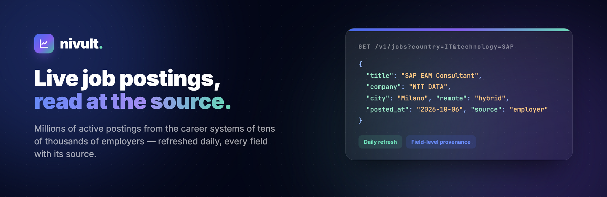

# Nivult Global Job Postings API

Query **6.3M+ active job postings** and **73,000+ company records** across **240+ countries and territories**. The maintained Nivult index covers **65 ATS platforms** and public employment sources, with daily refreshes and closed-posting detection.

Search postings from **Workday, Greenhouse, Lever, Ashby, SmartRecruiters, iCIMS, SAP SuccessFactors**, and other supported sources. No career-site URLs or employer credentials are required, and no scraping happens during your run.

Use the dataset for labor-market research, talent intelligence, recruiter sourcing, competitor monitoring, lead generation, and location or technology hiring analysis.

## Quick start

```json
{
  "tipo": "jobs",
  "country": "US",
  "technology": "Snowflake",
  "q": "data",
  "limite": 10
}
```

Run the Actor and download the default dataset as JSON, CSV, or Excel, or read it through the Apify API.

## Input

| Field | Applies to | Description |
| --- | --- | --- |
| `tipo` | Both | `jobs` (default) or `companies`. |
| `country` | Both | ISO 3166-1 alpha-2 country code; comma-separated values are ORed. Empty means worldwide. |
| `category` | Jobs | Job-family category; comma-separated values are ORed. |
| `ats` | Jobs | Source platform slug such as `workday`, `greenhouse`, `lever`, `ashby`, `smartrecruiters`, `icims`, or `successfactors`; comma-separated values are ORed. |
| `technology` | Both | Jobs: normalized technology extracted from the posting. Companies: company-level technology aggregate. |
| `q` | Both | Jobs: all terms must match the title or description. Companies: case-insensitive company-name search. |
| `seniority` | Jobs | `intern`, `junior`, `mid`, `senior`, `lead`, or `head`. |
| `remote` | Jobs | `remote`, `hybrid`, or `onsite`. |
| `language` | Jobs | ISO language code such as `en`, `de`, or `it`. |
| `dal` | Jobs | Inclusive posted-after ISO 8601 date or timestamp. Dates can be estimated when a source does not provide one. |
| `industry` | Companies | Exact industry value on the company record. |
| `employees_min`, `employees_max` | Companies | Employee-count bounds. |
| `limite` | Both | Maximum rows per run: 1–5,000; default 100. |

Filters that do not apply to the selected result type are ignored. Company mode is not a distinct-employers query over a filtered job slice: it queries company records directly.

## Company mode

```json
{
  "tipo": "companies",
  "country": "IT",
  "technology": "SAP",
  "industry": "Software",
  "employees_min": 100,
  "limite": 100
}
```

Company records are keyed by **`ats + company_slug`**, not by slug alone. Available fields include employer name, domain, active-job count, industry, legal and registration data, size band, locations, technology stack, and selected source fields. Enrichment is optional and varies by employer.

## Job output

A selected subset of a job record:

```json
{
  "title": "Logistics Deduction Management Analyst",
  "company": "Hisenseusacorporation",
  "company_slug": "hisenseusacorporation",
  "ats": "bamboohr",
  "country": "US",
  "city": "Alpharetta",
  "remote": "onsite",
  "seniority": "junior",
  "technologies": ["Excel", "Microsoft Office", "PowerPoint", "SAP", "Word"],
  "posted_at": "2026-10-06T00:00:00+00:00",
  "url": "https://hisenseusacorporation.bamboohr.com/careers/349"
}
```

Each job row includes its ATS and source URL. `first_seen` and `last_seen` are normally present. Description, location, employment type, skills, technologies, seniority, workplace, language, and observed salary are available on covered records; they can be omitted or empty when unavailable. Provenance is exposed for selected enriched fields, not every field.

## Pricing and limits

Tiered Pay-Per-Event pricing, plus the standard **$0.00005 Actor Start** event:

| Apify subscription tier | Jobs / 1,000 | Company records / 1,000 |
| --- | ---: | ---: |
| Free | $6.00 | $18.00 |
| Bronze (Starter) | $5.40 | $16.20 |
| Silver (Scale) | $4.80 | $14.40 |
| Gold (Business) | $4.20 | $12.60 |

Empty results have no result-event charge. A single run returns at most **5,000 rows**. Empty filters run a worldwide query; they are not an empty result.

## Need higher volume, daily bulk exports, or specific companies?

The direct API at [nivult.com](https://nivult.com) supports volumes beyond 5,000 jobs per run, Daily Delta feeds, Daily bulk JSONL exports, and requests to add missing companies across the 65 supported ATS platforms on Scale and Business plans. Enterprise options include historical backfill, custom company lists including non-standard career sites, and redistribution licensing. Direct plans reach **€0.60 per 1,000 credits** on Business; custom Enterprise volumes start at 5M credits per month.

## Data freshness and sources

The index is refreshed and deduplicated daily. Records come from supported employer ATS platforms, career sites, staffing sources, and public employment portals; coverage is not limited to the seven ATS platforms highlighted above. A run queries the maintained index and does not rescrape or re-enrich records on demand.

## Explore the Nivult family

- [Global Job Postings API](https://apify.com/nivult/global-job-postings)
- [Workday Jobs API](https://apify.com/nivult/workday-jobs-dataset)
- [Greenhouse Jobs API](https://apify.com/nivult/greenhouse-jobs-dataset)
- [Jobs by Technology](https://apify.com/nivult/jobs-by-technology)

Questions, feedback, and custom feed requests: **hello@nivult.com**.
