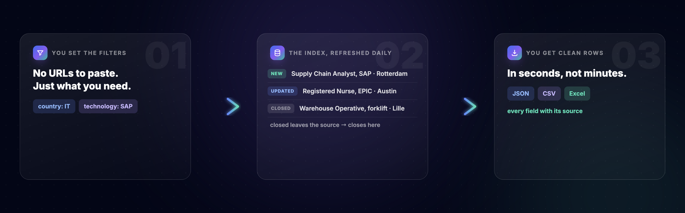

Query **5.9M+ active job postings** from **69K+ companies** across **242 countries** and **65 ATS platforms**. The maintained Nivult index is refreshed **every 24 hours**.

**No scraping happens during your run.** This Actor queries the existing index with your filters; you do not need to provide career-site URLs or employer credentials. Download the resulting dataset as JSON, CSV, or Excel, or read it through the Apify API.

Use it for labor-market research, recruiter sourcing, competitor monitoring, lead generation, and location or technology hiring analysis.



## Quick start

Paste this input into the Actor console for a small sample:

```json
{
  "tipo": "jobs",
  "country": "US",
  "technology": "Snowflake",
  "q": "data",
  "seniority": "",
  "remote": "",
  "dal": "2026-10-01",
  "limite": 10
}
```

Or run the same query through Apify. Replace `APIFY_TOKEN` with your own token:

```bash
curl --request POST \
  --url 'https://api.apify.com/v2/acts/nivult~global-job-postings/run-sync-get-dataset-items?token=APIFY_TOKEN' \
  --header 'Content-Type: application/json' \
  --data '{"tipo":"jobs","country":"US","technology":"Snowflake","q":"data","limite":10}'
```

## Input

| Field | Type | Default | Description |
|---|---|---|---|
| `tipo` | string | `jobs` | `jobs` returns individual postings; `companies` returns employer records. |
| `country` | string | empty | ISO 3166-1 alpha-2 country code, such as `IT`, `DE`, or `US`; empty means worldwide. |
| `technology` | string | empty | Technology found in posting text, such as `SAP`, `Snowflake`, or `Kubernetes`. |
| `q` | string | empty | Jobs: keyword search in titles and descriptions. Companies: case-insensitive company-name search. |
| `seniority` | string | empty | `intern`, `junior`, `mid`, `senior`, `lead`, or `head`; empty includes all values. Jobs only. |
| `remote` | string | empty | `remote`, `hybrid`, or `onsite`; empty includes all values. Jobs only. |
| `dal` | string | empty | ISO date `YYYY-MM-DD`; returns postings dated on or after this date. Jobs only. |
| `limite` | integer | `100` | Maximum rows, from 1 to 10,000. The console prefill is 10 for a quick sample. |

In company mode, `q` searches company names, `country` filters the country on the company record, and `technology` filters the company-level technology aggregate. This is not a distinct-employers query over the filtered job slice. Job-only filters are ignored.

## Company mode for employer lead lists

Return company records instead of individual postings:

```json
{
  "tipo": "companies",
  "country": "IT",
  "technology": "SAP",
  "limite": 10
}
```

Selected fields from an existing company-mode example:

```json
{
  "company": "Italgas",
  "domain": "italgas.it",
  "active_jobs": 92,
  "industry": "Distribution of gaseous fuels",
  "industry_source": "wikidata",
  "legal_name": "ITALGAS S.P.A.",
  "legal_form": "Società Per Azioni",
  "registration_id": "815600F25FF44EF1FA76",
  "founded": "2016-05-31",
  "size_range": "1001-5000",
  "size_range_source": "pdl (free dataset)"
}
```

Company attributes and their sources are optional; availability varies by employer.

## Job output

Selected fields from an existing job record, with unrelated optional fields omitted:

```json
{
  "title": "Logistics Deduction Management Analyst",
  "company": "Hisenseusacorporation",
  "ats": "bamboohr",
  "country": "US",
  "city": "Alpharetta",
  "remote": "onsite",
  "seniority": "junior",
  "technologies": ["Excel", "Microsoft Office", "PowerPoint", "SAP", "Word"],
  "posted_at": "2026-10-06T00:00:00+00:00",
  "url": "https://hisenseusacorporation.bamboohr.com/careers/349"
}
```

Each job row includes its ATS and source URL. `first_seen` and `last_seen` are normally present. Enriched fields are optional and may be omitted or empty when unavailable.

## Pricing

You pay only for rows returned, whether they are jobs or company records.

| Rows returned | Dataset-item cost |
|---:|---:|
| 100 | $0.30 |
| 1,000 | $3.00 |
| 10,000 | $30.00 |

**An empty result costs $0 in dataset-item charges.** A full 10,000-row result costs $30 in dataset-item charges; the standard Actor Start event may also apply.

## Coverage, dates, and limits

Coverage snapshot — **21 November 2026**, across the overall index. Values vary by export, source and filtered slice; these figures are not a promise that every row contains every field.

| Field | Rows covered |
|---|---:|
| `description` | 95.4% |
| `language` | 91.1% |
| `category` | 97.2% |
| `country` | 89.4% |
| `skills` | 65.2% |
| `employment_type` | 80.7% |
| `seniority` | 56.7% |
| `remote` | 55.7% |
| `technologies` | 31.6% |
| Observed salary | 22.7% |
| Estimated salary | 0.0% |
| `job_sources` | 1.9% |

Salary estimates are not currently populated; observed salary information is available only on part of the index. Provenance and enrichment are not guaranteed on every row or field.

Posting dates can be estimated when a source does not expose an exact publication date, so `posted_at` and the `dal` filter may use an estimated date. Refresh cycles deduplicate records and update the active index; a run does not rescrape or re-enrich rows on demand.

A single run returns at most 10,000 rows. For larger slices or a daily export, contact **hello@nivult.com**.

## Explore the Nivult family

- [Workday Jobs API — Global ATS Dataset](https://apify.com/nivult/workday-jobs-dataset)
- [Greenhouse Jobs API — Global ATS Dataset](https://apify.com/nivult/greenhouse-jobs-dataset)
- [Jobs by Technology — Tech Hiring Leads](https://apify.com/nivult/jobs-by-technology)

Questions, feedback, and custom feed requests: **hello@nivult.com**.
