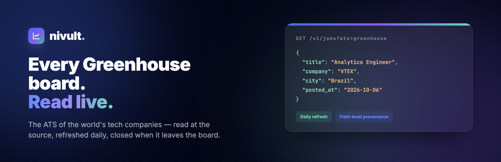
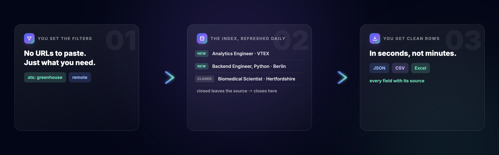

Export structured Greenhouse job postings without supplying board URLs or running a scraper. The underlying Nivult index contains **5.9M+ active job postings** from **69K+ companies** across **242 countries** and **65 ATS platforms**, refreshed **every 24 hours**. These figures describe the full index, not a Greenhouse-only count.

**No scraping happens during your run.** The Actor queries the maintained index and returns its Greenhouse slice with your filters. Use it to track startup and technology hiring, monitor employers, research roles, or feed recruiting analytics.



## Quick start

Paste this input into the Actor console:

```json
{
  "tipo": "jobs",
  "country": "DE",
  "q": "product",
  "seniority": "",
  "remote": "hybrid",
  "dal": "2026-10-01",
  "limite": 10
}
```

Or call the Actor through Apify. Replace `APIFY_TOKEN` with your own token:

```bash
curl --request POST \
  --url 'https://api.apify.com/v2/acts/nivult~greenhouse-jobs-dataset/run-sync-get-dataset-items?token=APIFY_TOKEN' \
  --header 'Content-Type: application/json' \
  --data '{"tipo":"jobs","country":"DE","q":"product","remote":"hybrid","limite":10}'
```

## Input

| Field | Type | Default | Description |
|---|---|---|---|
| `tipo` | string | `jobs` | `jobs` returns Greenhouse postings; `companies` returns employer records. |
| `country` | string | empty | ISO 3166-1 alpha-2 code, such as `IT`, `DE`, or `US`; empty means worldwide. |
| `technology` | string | empty | Technology found in posting text, such as `SAP`, `Snowflake`, or `Kubernetes`. |
| `q` | string | empty | Jobs: keyword search in titles and descriptions. Companies: case-insensitive company-name search. |
| `seniority` | string | empty | `intern`, `junior`, `mid`, `senior`, `lead`, or `head`; empty includes all values. Jobs only. |
| `remote` | string | empty | `remote`, `hybrid`, or `onsite`; empty includes all values. Jobs only. |
| `dal` | string | empty | ISO date `YYYY-MM-DD`; returns postings dated on or after this date. Jobs only. |
| `limite` | integer | `100` | Maximum rows, from 1 to 10,000. The console prefill is 10 for a quick sample. |

The Greenhouse preset applies only to job searches. Company mode uses the full employer index, not only Greenhouse employers: `q` searches company names, `country` filters the company record, and `technology` filters its company-level aggregate. It is not a distinct-employers query over the filtered job slice. Job-only filters are ignored.

## Output

Selected fields from an existing Greenhouse job record, with unrelated optional fields omitted:

```json
{
  "title": "Summer Internship 2027",
  "company": "Hankooktireamericacorp",
  "ats": "greenhouse",
  "country": "US",
  "remote": "onsite",
  "seniority": "intern",
  "language": "en",
  "technologies": ["MS-Office"],
  "posted_at": "2026-10-06T00:00:00+00:00",
  "url": "https://job-boards.greenhouse.io/hankooktireamericacorp/jobs/5445258008"
}
```

Each job row includes its ATS and source URL. `first_seen` and `last_seen` are normally present. Enriched fields are optional and may be omitted or empty when unavailable. Download the default dataset as JSON, CSV, or Excel, or consume it through the Apify API.

## Pricing

You pay only for rows returned, whether they are jobs or company records.

| Rows returned | Dataset-item cost |
|---:|---:|
| 100 | $0.20 |
| 1,000 | $2.00 |
| 10,000 | $20.00 |

**An empty result costs $0 in dataset-item charges.** A full 10,000-row result costs $20 in dataset-item charges; the standard Actor Start event may also apply.

## Coverage, dates, and limits

Coverage snapshot — **21 November 2026**, across the overall Nivult index. Values vary by export, source and filtered slice, including the Greenhouse slice.

| Field | Rows covered |
|---|---:|
| `description` | 95.4% |
| `language` | 91.1% |
| `category` | 97.2% |
| `country` | 89.4% |
| `skills` | 65.2% |
| `employment_type` | 80.7% |
| `seniority` | 56.7% |
| `remote` | 55.7% |
| `technologies` | 31.6% |
| Observed salary | 22.7% |
| Estimated salary | 0.0% |
| `job_sources` | 1.9% |

Salary estimates are not currently populated; observed salary information is available only on part of the index. Provenance and enrichment are not guaranteed on every row or field.

Posting dates can be estimated when a source does not expose an exact publication date, so `posted_at` and the `dal` filter may use an estimated date. Refresh cycles deduplicate records and update active postings; a run does not rescrape or re-enrich rows on demand.

A single run returns at most 10,000 rows. This is an independent index of public job postings, not the official Greenhouse API, and it requires no Greenhouse credentials. For larger slices or a daily export, contact **hello@nivult.com**.

## Explore the Nivult family

- [Global Job Postings API — ATS Dataset](https://apify.com/nivult/global-job-postings)
- [Workday Jobs API — Global ATS Dataset](https://apify.com/nivult/workday-jobs-dataset)
- [Jobs by Technology — Tech Hiring Leads](https://apify.com/nivult/jobs-by-technology)

Questions, feedback, and custom feed requests: **hello@nivult.com**.
