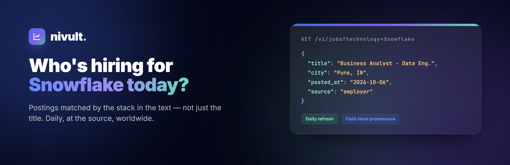
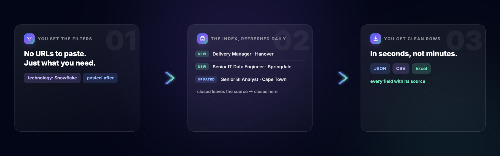

Find **companies hiring by tech stack** and turn job postings into **B2B hiring signals**. Search technologies such as Snowflake, SAP, Salesforce, or Kubernetes in an index of **5.9M+ active job postings** from **69K+ companies** across **242 countries** and **65 ATS platforms**, refreshed **every 24 hours**.

**No scraping happens during your run.** The Actor queries the maintained Nivult index with your technology and other filters. Use it for technology-focused lead generation, account research, recruiter sourcing, competitor analysis, and hiring-demand monitoring.



## Quick start

Paste this input into the Actor console for a small Snowflake sample:

```json
{
  "tipo": "jobs",
  "technology": "Snowflake",
  "country": "US",
  "q": "",
  "seniority": "",
  "remote": "",
  "dal": "2026-10-01",
  "limite": 10
}
```

Or call the Actor through Apify. Replace `APIFY_TOKEN` with your own token:

```bash
curl --request POST \
  --url 'https://api.apify.com/v2/acts/nivult~jobs-by-technology/run-sync-get-dataset-items?token=APIFY_TOKEN' \
  --header 'Content-Type: application/json' \
  --data '{"tipo":"jobs","technology":"Snowflake","country":"US","limite":10}'
```

Other targeting examples:

```json
{
  "tipo": "jobs",
  "technology": "SAP",
  "country": "DE",
  "seniority": "senior",
  "limite": 10
}
```

```json
{
  "tipo": "jobs",
  "technology": "Salesforce",
  "remote": "remote",
  "limite": 10
}
```

## Input

| Field | Type | Default | Description |
|---|---|---|---|
| `tipo` | string | `jobs` | `jobs` returns matching postings; `companies` returns company records filtered by the company-level fields described below. |
| `country` | string | empty | ISO 3166-1 alpha-2 code, such as `IT`, `DE`, or `US`; empty means worldwide. |
| `technology` | string | empty | Technology found in posting text. The console prefill is `Snowflake`. |
| `q` | string | empty | Jobs: additional keyword search in titles and descriptions. Companies: case-insensitive company-name search. |
| `seniority` | string | empty | `intern`, `junior`, `mid`, `senior`, `lead`, or `head`; empty includes all values. Jobs only. |
| `remote` | string | empty | `remote`, `hybrid`, or `onsite`; empty includes all values. Jobs only. |
| `dal` | string | empty | ISO date `YYYY-MM-DD`; returns postings dated on or after this date. Jobs only. |
| `limite` | integer | `100` | Maximum rows, from 1 to 10,000. The console prefill is 10 for a quick sample. |

In company mode, `q` searches company names, `country` filters the country on the company record, and `technology` filters the company-level technology aggregate. It is not a distinct-employers query over the filtered job slice. Job-only filters are ignored.

## Company mode for tech-stack lead lists

Return company records instead of individual postings:

```json
{
  "tipo": "companies",
  "technology": "Snowflake",
  "country": "US",
  "limite": 10
}
```

Use this mode to build account lists from the company-level index. A technology match may reflect the exported company aggregate and does not prove that the same technology appears in every currently active posting. Company attributes are optional and vary by employer; the output structure is the same as in the Global actor.

## Job output

Selected fields from an existing Snowflake-matching job record, with unrelated optional fields omitted:

```json
{
  "title": "Delivery Manager - Data Analytics Spread & Commissions",
  "company": "Careers Allegisgroup",
  "ats": "icims",
  "country": "US",
  "city": "Hanover",
  "skills": ["python", "sql", "aws", "azure", "gcp", "etl", "scrum", "agile", "project management", "warehouse", "snowflake", "unstructured data", "use logical reasoning"],
  "posted_at": "2026-10-06T00:00:00+00:00",
  "url": "https://careers-allegisgroup.icims.com/jobs/2384/delivery-manager---data-analytics-spread-%26-commissions/job"
}
```

Each job row includes its ATS and source URL. `first_seen` and `last_seen` are normally present. Enriched fields are optional and may be omitted or empty when unavailable. Download the default dataset as JSON, CSV, or Excel, or consume it through the Apify API.

## Pricing

You pay only for rows returned, whether they are jobs or company records.

| Rows returned | Dataset-item cost |
|---:|---:|
| 100 | $0.30 |
| 1,000 | $3.00 |
| 10,000 | $30.00 |

**An empty result costs $0 in dataset-item charges.** A full 10,000-row result costs $30 in dataset-item charges; the standard Actor Start event may also apply.

## Coverage, dates, and limits

Coverage snapshot — **21 November 2026**, across the overall index. Values vary by export, source and filtered slice; these figures are not a promise that every row contains every field.

| Field | Rows covered |
|---|---:|
| `description` | 95.4% |
| `language` | 91.1% |
| `category` | 97.2% |
| `country` | 89.4% |
| `skills` | 65.2% |
| `employment_type` | 80.7% |
| `seniority` | 56.7% |
| `remote` | 55.7% |
| `technologies` | 31.6% |
| Observed salary | 22.7% |
| Estimated salary | 0.0% |
| `job_sources` | 1.9% |

Technology extraction covers 31.6% of the overall index in the snapshot above, so a missing technology value does not prove that a posting does not mention that stack. Salary estimates are not currently populated; observed salary information is available only on part of the index. Provenance and enrichment are not guaranteed on every row or field.

Posting dates can be estimated when a source does not expose an exact publication date, so `posted_at` and the `dal` filter may use an estimated date. Refresh cycles deduplicate records and update the active index; a run does not rescrape or re-enrich rows on demand.

A single run returns at most 10,000 rows. For larger slices, a recurring technology feed, or a daily export, contact **hello@nivult.com**.

## Explore the Nivult family

- [Global Job Postings API — ATS Dataset](https://apify.com/nivult/global-job-postings)
- [Workday Jobs API — Global ATS Dataset](https://apify.com/nivult/workday-jobs-dataset)
- [Greenhouse Jobs API — Global ATS Dataset](https://apify.com/nivult/greenhouse-jobs-dataset)

Questions, feedback, and custom feed requests: **hello@nivult.com**.
